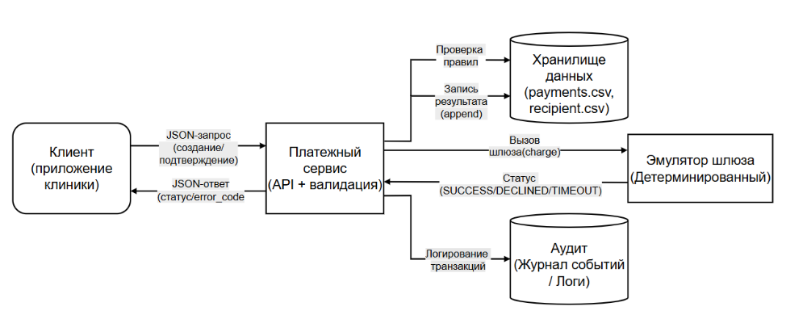
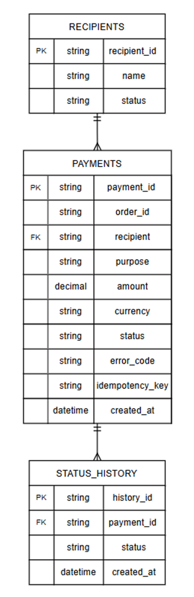
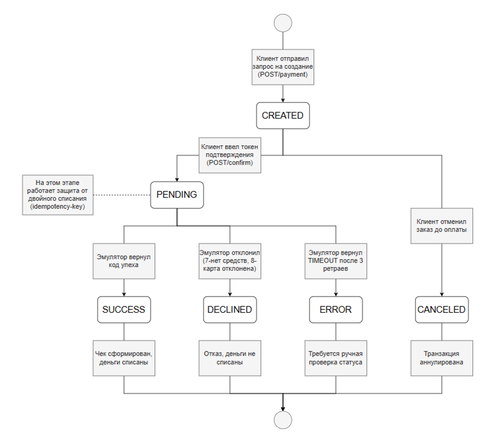
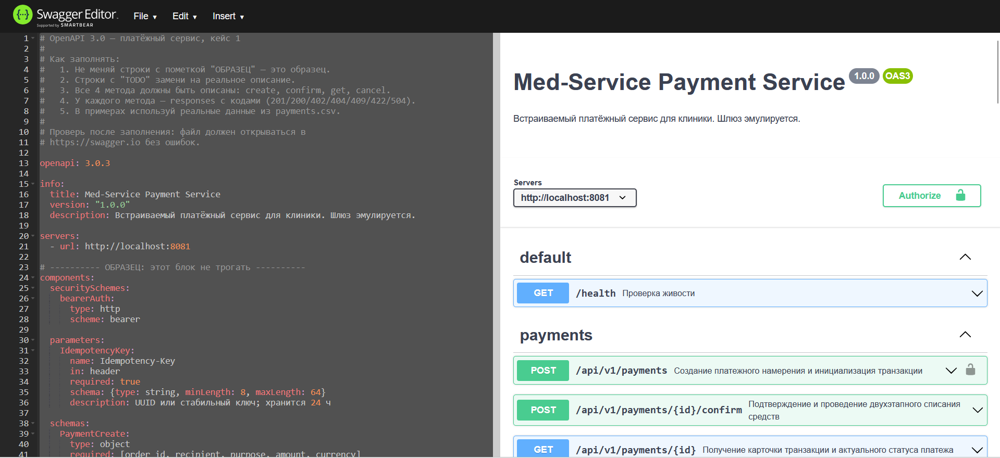
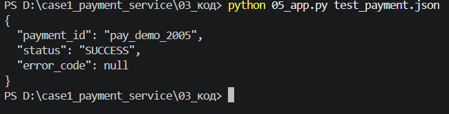
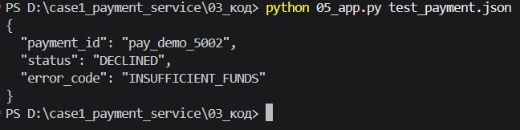
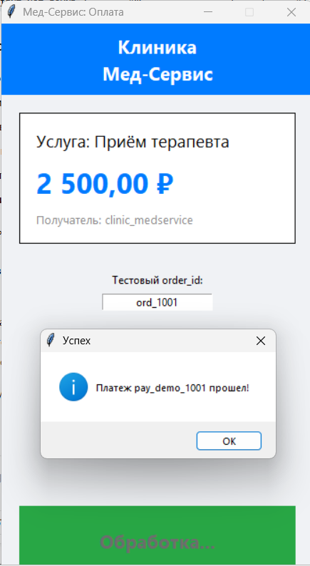
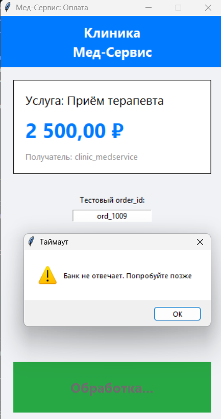
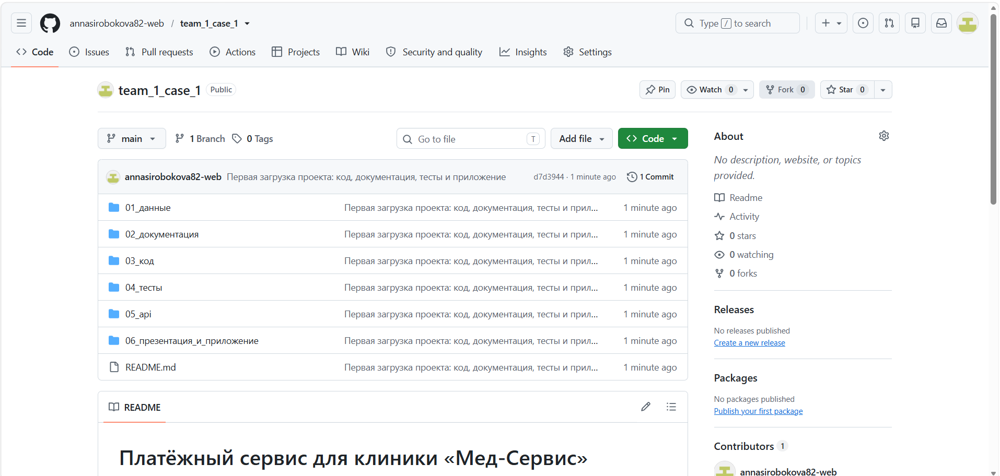

# ПРИЛОЖЕНИЕ К ПРОЕКТУ
**Кейс:** «Платёжный сервис: безопасный платёж за услугу»
**Команда:** API-молодцы

Вольхина Е.А. - Дизайнер схем

Боронина М.А. - Аналитик

Мангушева А.А. - Тестировщик 

Кузнецов Р.Н. - Специалист по ИБ

Широбокова А.М. - Разработчик 

---

## А. Диаграммы

### А.1. Схема системы
На схеме отражено взаимодействие клиентского приложения, платёжного сервиса, эмулятора шлюза и хранилища данных.

  
  
<i>Рисунок 1 — Схема архитектуры платёжного сервиса</i>

### А.2. ER-модель (Схема данных)
Модель данных описывает сущности платежей, справочник получателей (филиалов) и историю статусов.

  
  
<i>Рисунок 2 — ER-модель базы данных</i>

### А.3. Схема состояний платежа
Диаграмма показывает жизненный цикл транзакции и переходы между статусами.

  
  
<i>Рисунок 3 — Жизненный цикл платежа</i>

---

## Б. Пользовательские сценарии
В рамках проектирования сервиса были разработаны ключевые сценарии взаимодействия пациента с клиникой. Это позволило учесть все потребности конечных пользователей и сотрудников клиники.

1. **Оплата услуги:** Пациент выбирает врача в мобильном приложении, нажимает «Оплатить». Сервис отправляет JSON-запрос, валидирует данные (сумма, валюта, статус филиала) и возвращает статус `SUCCESS`. Пациенту приходит SMS с подтверждением.
2. **Отмена записи с возвратом:** Если пациент отменил запись за 24 часа до приема, клиника вызывает метод `/refund`. Деньги возвращаются на карту пациента, а в базе обновляется статус платежа на `REFUNDED`.
3. **Уведомление клиники:** После успешной оплаты в CRM клиники (администратору) приходит уведомление о новом платеже, чтобы подготовить карту пациента и подтвердить запись к врачу.

---

## В. Таблицы

### В.1. Правила валидации
| ID | Условие | Действие | Код ошибки |
|---|---|---|---|
| V-1 | обязательное поле пустое | отклонить | VALIDATION_ERROR |
| V-2 | order_id не по regex `^[A-Za-z0-9_\-]{1,64}$` | отклонить | INVALID_FORMAT |
| V-3 | amount ≤ 0 или > 1 000 000 | отклонить | AMOUNT_OUT_OF_RANGE |
| V-4 | currency не в [RUB] | отклонить | UNSUPPORTED_CURRENCY |
| V-5 | recipient не в recipients.csv или status ≠ ACTIVE | отклонить | RECIPIENT_NOT_FOUND |
| V-6 | purpose длиннее 200 символов или содержит PAN (`\d{13,19}`) | отклонить | INVALID_PURPOSE |
| V-7 | amount имеет больше 2 знаков после десятичной точки | отклонить | INVALID_AMOUNT_PRECISION |
| V-8 | пара order_id + recipient уже существует в реестре платежей | отклонить (409) | DUPLICATE_ORDER |
| V-9 | повтор существующего Idempotency-Key с идентичными данными | отклонить | DUPLICATE_REQUEST |
| V-9a| Idempotency-Key не передан в заголовках со стороны клиента | вычислить составной ключ| — |
| V-9b| повтор Idempotency-Key с измененными параметрами платежа | отклонить (409) | IDEMPOTENCY_KEY_MISMATCH |
| ИБ-1| разница времени Timestamp сервера и клиента превышает 300 с | отклонить (401) | REPLAY_DETECTED |
| ИБ-2| идентификатор X-Nonce уже присутствует в реестре использованных| отклонить (401) | REPLAY_DETECTED |
| V-10| use_bonus > баланса пациента ИЛИuse_bonus > 30% от amount | отклонить (422) | BONUS_LIMIT_EXCEEDED |

### В.2. Матрица «вход → код ошибки → HTTP»
| Ситуация | Код ошибки | HTTP | Retryable |
|---|---|---|---|
| Обязательное поле пустое | VALIDATION_ERROR | 422 | Нет |
| order_id не по regex | INVALID_FORMAT | 422 | Нет |
| Сумма <= 0 или > 1 000 000 | AMOUNT_OUT_OF_RANGE | 422 | Нет |
| Валюта не RUB | UNSUPPORTED_CURRENCY | 422 | Нет |
| Получатель не найден или INACTIVE | RECIPIENT_NOT_FOUND | 404 | Нет |
| Дублирование заказа | DUPLICATE_ORDER | 409 | Нет |
| Таймаут шлюза | GATEWAY_TIMEOUT | 504 | Да (3 попытки) |

### В.3. Тесты
| ID | Название | Входные данные (JSON) | Ожидаемый результат | Факт (что выдала программа) | Статус |
|---|---|---|---|---|---|
| Т1-1 | Успешный платеж | `order_id: "ord_1001"`, `amount: 2500`, `currency: "RUB"` | Статус `SUCCESS`, HTTP 200 | Скрипт вернул статус SUCCESS. В интерфейсе появилось окно "Платеж pay_demo_1001 прошел!". | Пройден |
| Т1-2 | Отклонение (Недостаточно средств) | `order_id: "ord_1002"`, `amount: 1800`, `currency: "RUB"` | Статус `DECLINED`, `error_code: INSUFFICIENT_FUNDS` | В интерфейсе появилось окно "Отказ банка: Недостаточно средств на карте". | Пройден|
| Т1-3 | Ошибка валидации (Неверная сумма) | `order_id: "ord_1003"`, `amount: -100`, `currency: "RUB"` | Статус `ERROR`, `error_code: AMOUNT_OUT_OF_RANGE` | В интерфейсе появилось окно "Ошибка: Неверная сумма платежа". | Пройден|
| Т1-4 | Ошибка валидации (Неверный получатель) | `recipient: "clinic_medservice_old"`, `order_id: "ord_1004"` | Статус `ERROR`, `error_code: RECIPIENT_NOT_FOUND` | В интерфейсе появилось окно "Ошибка: Получатель не найден или филиал закрыт". | Пройден |
| Т1-5 | Таймаут шлюза | `order_id: "ord_1009"`, `amount: 900`, `currency: "RUB"` | Статус `TIMEOUT`, `error_code: GATEWAY_TIMEOUT`, Exit code 3 | В интерфейсе появилось окно "Таймаут: Банк не отвечает. Попробуйте позже". | Пройден |
| Т1-6 | Защита от дублей | `Idempotency-Key`,`order_id: "ord_1001"` | Статус ERROR, error_code: DUPLICATE_ORDER | В интерфейсе появилось окно "Дубликат заказа: Этот заказ уже был оплачен ранее". | Пройден |

---

## С. Журнал промптов (ИИ)
| Дата | Цель | Промпт (сжато) | Результат | Проверка | Использовано |
|---|---|---|---|---|---|
| 04.11 | Понять, что такое идемпотентность | "объясни простыми словами что такое Idempotency-Key в платежах" | Объяснил, что это защита от двойного списания при повторном нажатии кнопки | Внесли правило V-9 в 02_правила.md | Да, добавили в правила |
| 04.11 | Понять схему состояний | "какие статусы обычно бывают у платежа от создания до завершения" | Перечислил: CREATED, PENDING, SUCCESS, DECLINED, CANCELED | Нарисовали схему жизненного цикла для приложения | Да, добавили в приложение |
| 04.11 | Понять стандарт описания API | "что такое OpenAPI 3.0 и зачем он нужен в разработке" | Объяснил, что это стандарт документации, по которому можно генерировать клиентский код | Прочитали статью по ссылке из ответа, поняли разницу с Swagger 2.0 | Да, использовали для структуры 06_openapi.yaml |
| 04.11 | Понять статус 202 | "какой HTTP код использовать для асинхронной отправки уведомлений по смс" | Ответил, что 202 Accepted — запрос принят в очередь, но еще не выполнен | Сверили с нашим сценарием уведомлений, согласились | Да, поставили 202 в методе /notifications |
| 04.11 | Понять разницу 422 и 400 | "в чем разница между HTTP 400 Bad Request и 422 Unprocessable Entity" | Объяснил, что 400 — это кривой JSON, а 422 — данные корректны синтаксически, но не прошли бизнес-валидацию (например, минусовая сумма) | Убедились, что для наших правил V-3 (сумма) нужен именно 422 | Да, исправили коды в 06_openapi.yaml |
| 04.11 | Узнать про HTTP-коды | "какой HTTP код ставить если получатель не найден в базе" | Ответил, что 404 Not Found | Сверили с таблицей в задании, согласились | Да |
| 05.11 | Понять ошибку кодировки | "питон выдает UnicodeDecodeError 0xca в position 44 что это" | Объяснил, что CSV сохранен в Windows-1251, а не в UTF-8 | Сохранили файл в UTF-8 через блокнот | Да, переписали файл |
| 05.11 | Починить кнопку в интерфейсе | "в tkinter кнопка остается нажатой после выполнения функции как вернуть обратно" | Подсказал использовать блок finally | Добавили `btn_pay.config(state=tk.NORMAL)` | Да, использовали блок finally |
| 06.11 | Понять, как делать возврат | "как в api описать возврат денег если пациент отменил запись" | Предложил метод POST /refund | Добавили в Swagger, описали схему | Да, переработали |
| 06.11 | Узнать про уведомления | "как в api описать отправку смс пациенту об успешной записи" | Подсказал создать метод POST /notifications | Добавили в Swagger новую схему | Да |
| 07.11 | Оформление приложения | "как в markdown быстро сделать красивую таблицу с картинками" | Написал пример синтаксиса | Скопировали код и вставили в 06_приложение.md | Да |
| 07.11 | Понять, как проверять API | "на каком сайте можно проверить api чтобы он не ругался на ошибки" | Подсказал Swagger Editor | Зашли на сайт, вставили код, увидели ошибки | Да, использовали сайт |

---

## Д. Риски проекта и способы их снижения
| Риск | Вероятность | Влияние | Меры по снижению |
|---|---|---|---|
| Двойное списание средств | Средняя | Высокое | Реализован механизм Idempotency-Key (правило V-9) и проверка дубликатов заказов (V-8) |
| Таймаут банковского шлюза | Высокая | Среднее | Реализована политика ретраев (3 попытки) с экспоненциальной задержкой |
| Утечка персональных данных | Низкая | Высокое | Валидация PAN-номеров (V-6), отсутствие хранения данных карт в открытом виде |
| Ошибка оператора при вводе данных | Средняя | Низкое | Строгая валидация всех полей на стороне сервиса (V-1...V-5) |

---

## D. Матрица вклада
| Участник | Файлы / Задачи | Часы | Подпись |
|---|---|---|---|
| Боронина М.А. | Аналитик | `04_requirements.md` (Требования), `06_openapi.yaml` (Описание API) | 13 | _______ |
| Широбокова А.М. | Разработчик | `05_app.py` (Бэкенд), `interface_demo.py` (Интерфейс), `07_confirmation.md` (Эмулятор шлюза), `08_gateway_emulator.md` (Логика ретраев) | 13 | _______ |
| Кузнецов Р.Н. | Специалист по ИБ | `02_правила.md` (Правила V-1...V-10), `03_data_dictionary.md` (Словарь данных) | 8 | _______ |
| Мангушева А.А. | Тестировщик | `03_тесты.md` (5 тест-сценариев), `test_payment.json` (Тестовые данные), прогон тестов в приложении | 6 | _______ |
| Вольхина Е.А. | Дизайнер | `05_презентация.pdf` (Слайды), `06_приложение.pdf` (Сборка документа) | 8 | _______ |

---

## Е. Артефакты

**Ссылка на Git-репозиторий:** `https://github.com/annasirobokova82-web/team_1_case_1`

### Е.1. Проверка API в Swagger Editor
Спецификация OpenAPI 3.0 успешно прошла валидацию в Swagger Editor (отсутствуют красные ошибки). Справа отображается сгенерированная документация со всеми методами (`/payments`, `/confirm`, `/refund`, `/notifications`).

  
  
<i>Рисунок 4 — Проверка валидности OpenAPI-спецификации в Swagger Editor</i>

### Е.2. Работа консольного прототипа
На скриншотах ниже представлены результаты работы консольного прототипа (файл `05_app.py`) для двух сценариев: успешная оплата и отказ банка.

  
  
<i>Рисунок 5 — Вывод успешного платежа (Т1-1) в консольном прототипе</i>

  
  
<i>Рисунок 6 — Вывод отказа банка (Т1-2) в консольном прототипе</i>

### Е.3. Работа визуального интерфейса
Интерфейс на Python (Tkinter) вызывает реальный бэкенд, передавая ему JSON-запрос, и отображает результат для пациента.

  
  
<i>Рисунок 7 — Демонстрация успешного проведения платежа</i>

  
  
<i>Рисунок 8 — Демонстрация таймаута банка </i>

### Е.4. Структура проекта 
Ниже представлен скриншот структуры проекта в Git.

  
  
<i>Рисунок 9 — Структура проекта в Git-репозитории</i>

